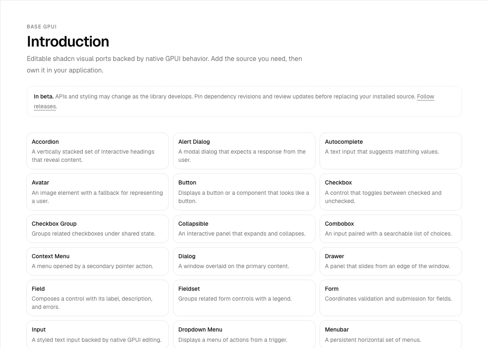

# gpuicn

<div align="center">
  
  <p>Native, editable UI components for <a href="https://www.gpui.rs/">GPUI</a>.</p>
  <p>
    <a href="https://ui.imajha.com/">Catalog</a> ·
    <a href="docs/registry.md">Install</a> ·
    <a href="docs/theming.md">Theming</a> ·
    <a href="https://github.com/devaryakjha/gpuicn/issues">Issues</a>
  </p>
</div>

gpuicn gives native [GPUI](https://www.gpui.rs/) apps 45 polished, shadcn-styled
components, from Button and Dialog to Sidebar, Resizable and Virtual List. Like
shadcn/ui, it copies the Rust source into your app, so you own every line and
can change any of it. Behavior comes from [GPUI Kit](https://github.com/longbridge/gpui-kit);
gpuicn adds the Nova styling, a themeable token system and larger desktop
components.

> [!WARNING]
> gpuicn is in beta. APIs and styling can change between releases; `gpuicn diff`
> shows exactly what an update would change in your copy.

## Quick start

```sh
cargo install gpuicn-cli --git https://github.com/devaryakjha/gpuicn --tag v0.5.0-beta.4 --locked
gpuicn new my-app  # cargo new + pinned deps, Geist fonts, theme, Button and a starter window
cd my-app && cargo run
gpuicn add sidebar dialog
```

That's the whole setup. No Node.js is involved. In an existing app, run
`gpuicn init` from its root instead of `gpuicn new`; it keeps everything you
already have. Installing the CLI also adds `cargo gpuicn` as an alias.

> [!NOTE]
> `gpuicn new` and the automatic `init` setup ship in the next CLI release. The
> v0.5.0-beta.4 CLI only writes `gpuicn.toml`; follow
> [manual setup](docs/registry.md#manual-setup) with it.

Then use components like any other Rust code in your crate:

```rust
use ui::button::Button;

Button::new("save")
    .label("Save")
    .on_click(cx.listener(|this, _, _, cx| this.save(cx)))
```

### Or use it as a crate

If you'd rather not keep the source in your app, use crate mode. Every component
comes from the `gpuicn` crate, and you copy out only the ones you want to change:

```sh
gpuicn new my-app --crate   # or `gpuicn init --crate` in an existing app
gpuicn eject button         # src/ui/button.rs is now yours; ui::button uses it
gpuicn remove button        # back to the crate's Button
```

Your code reads `ui::button::Button` either way, so moving a component between
the crate and your app never changes a call site. The theme always stays in the
crate, so every component reads the same theme.

<p align="center">
  
</p>

## Everyday commands

| Command | What it does |
| --- | --- |
| `gpuicn list` | Every component in the registry |
| `gpuicn add <name>…` | Copy components and the shared files they need; your edits are kept |
| `gpuicn status` | Which installed components differ from the registry |
| `gpuicn diff [name…]` | The exact change an update would make |
| `gpuicn add <name> --overwrite` | Replace your copy with the registry version |
| `gpuicn remove <name>…` | Delete a component, keeping files others still use |
| `gpuicn eject <name>…` | Crate mode: copy a component out of the crate to edit it |

## Learn more

- [Catalog](https://ui.imajha.com/): live GPUI/WASM previews, usage and API for every component
- [Install and update](docs/registry.md): what `init` does, manual setup, upgrading
- [Theming](docs/theming.md): colors, density, type, radius, motion, and importing shadcn themes
- [Changelog](CHANGELOG.md) and [release notes](docs/releases/)
- [gpui-icons](https://github.com/devaryakjha/gpui-icons): the full Lucide icon set the components use

## Requirements and platform scope

Rust 1.97 or newer. gpuicn v0.5.0-beta.4 targets GPUI Kit 0.6.4 and its pinned
`gpui-pre` 0.3.5 runtime; import GPUI types through `gpui_kit`. Apps on another
GPUI revision must migrate first. macOS native builds need Xcode's Metal toolchain;
Linux needs the usual GPUI system libraries (fontconfig, xkbcommon, Wayland/X11).

The browser catalog renders the same Rust components through WebGPU and WASM.
The WASM canvas does not expose a browser accessibility tree. Differences from
shadcn and platform limits are documented per component in `docs/parity/` and
in the catalog.

## Example app

```sh
cargo run --release -p gpuicn-showcase --features gpui_platform/runtime_shaders
```

gpuicn Workspace combines projects, tasks and local chat with saved state; pass
`-- --catalog` for the component gallery. See [showcase packaging](docs/showcase.md).

## Contributing

Bug reports, parity gaps and component requests are welcome as
[issues](https://github.com/devaryakjha/gpuicn/issues). See
[CONTRIBUTING.md](CONTRIBUTING.md) for the development setup, the checks to run,
and how to add a component. Project planning and validation records live in
[docs/internal](docs/internal/).

## License

gpuicn is available under the [MIT License](LICENSE).
