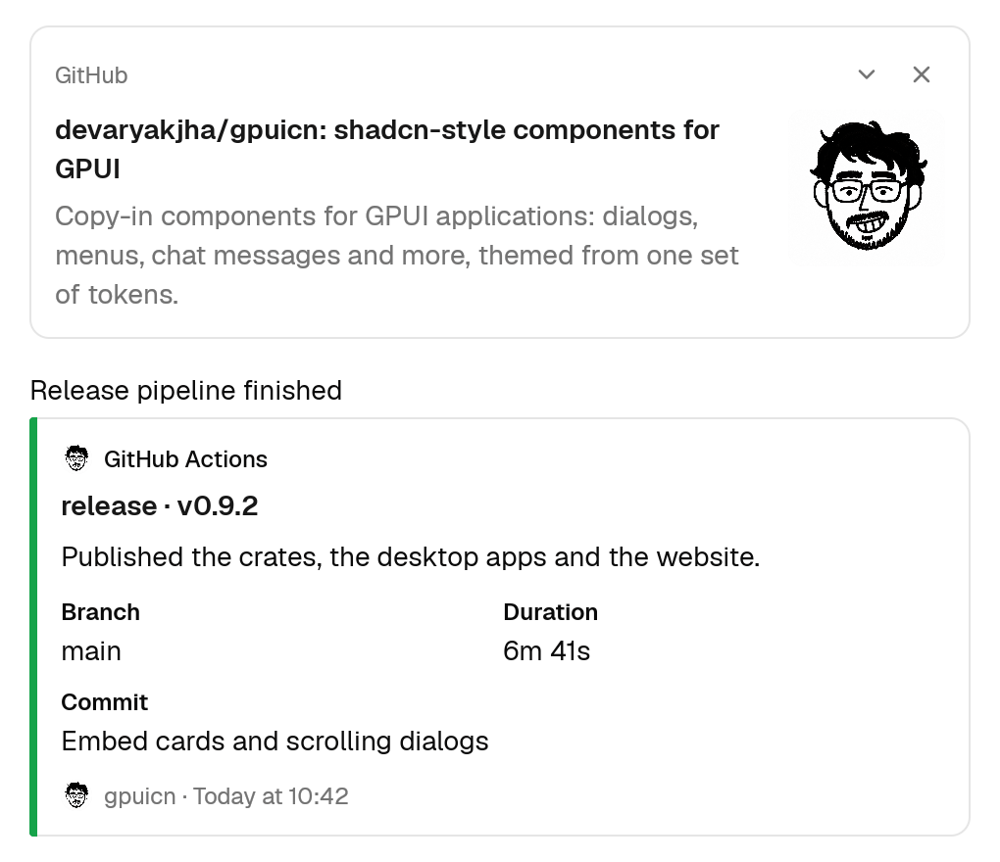
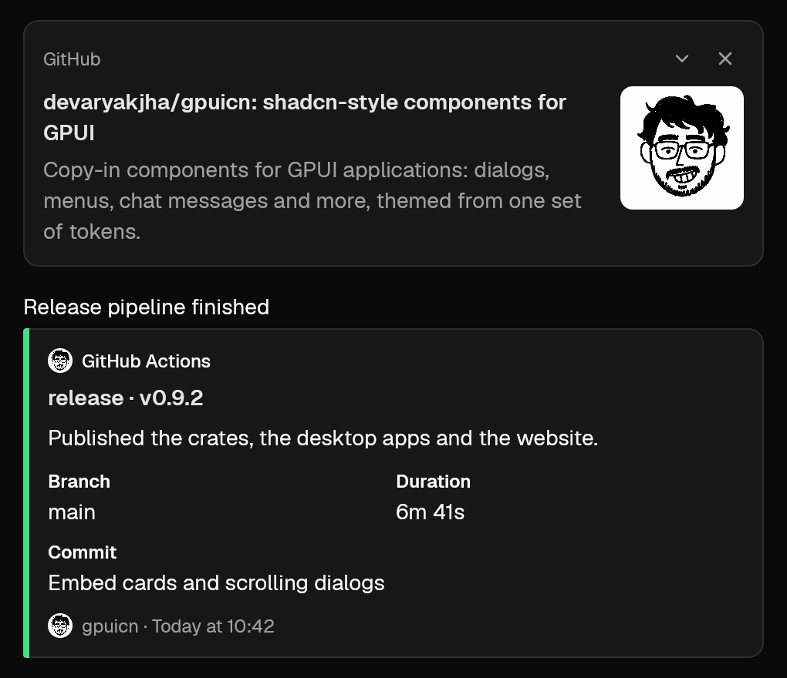

# gpuicn v0.9.2

Two requests from Matty: a new Embed component for cards under a chat
message, and dialogs taller than the window now scroll under the pointer.
Every change is additive; the runtime pins are unchanged: GPUI Kit 0.9.0 on
`gpui-pre` 0.3.11 and gpui-icons 0.6.0.

## Added

- **Embed** (`gpuicn add embed`): two cards for what a chat server attaches to
  a post (#108).
  - `LinkPreview` is an Open Graph preview: a muted site name, a title that
    wraps to two lines and opens the link, a description clamped to three
    lines, and an image. The image is large below the text, or a thumbnail
    on the right when it is narrower than 150px or roughly square. The caller
    passes its pixel size, so the card holds the box before the bytes load.
    `on_toggle` adds a "Collapse preview" / "Expand preview" chevron that
    hides the image, and `on_remove` adds a "Remove preview" button.
  - `MessageEmbed` is the integration attachment: a colored bar (any color,
    a hex string, or `good`, `warning` and `danger`), pretext, an author line
    with an icon, a title, a body slot for your Markdown, a fields grid with
    short fields two to a row, an image, a thumbnail and a footer with an
    icon and a time.
  - Both follow `MessageDensity`, read every color from the theme, and are
    groups named by their title. Linked titles take focus and open on Enter.




## Fixed

- **Dialog**: a dialog taller than the window scrolls with the wheel over its
  surface. `dialog_popup` used `occlude()`, which hid the wheel from the
  dialog's scrolling viewport, so the content stayed clipped. It now uses
  `block_mouse_except_scroll()`: clicks and hover still stop at the surface,
  and the backdrop still keeps the wheel from the page behind. If you built
  your own surface for `dialog` with `occlude()`, switch it the same way
  (#109).

## Upgrading

```sh
cargo install gpuicn-cli --version 0.9.2 --locked
gpuicn update --to 0.9.2
```

Crate users: `cargo update -p gpuicn`.
