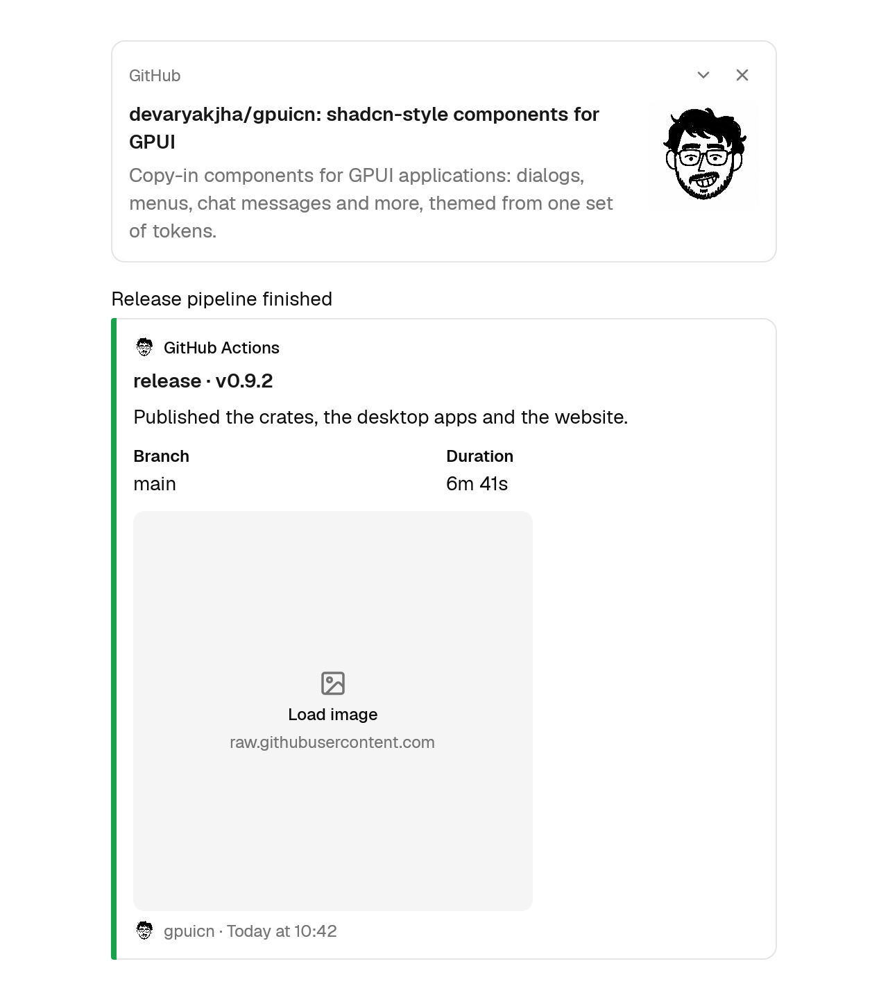
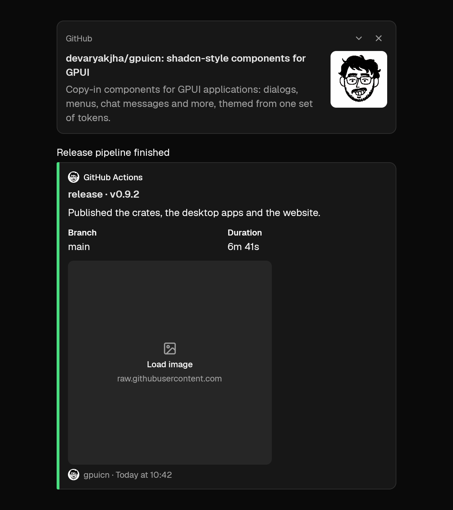

# gpuicn v0.9.3

A request from Matty: embed cards can hold a click-to-load placeholder where
their image goes, for applications that ask before loading remote images.
The change is additive; the runtime pins are unchanged: GPUI Kit 0.9.0 on
`gpui-pre` 0.3.11 and gpui-icons 0.6.0.

## Added

- **Embed**: `ImagePlaceholder`, passed to `LinkPreview::image_placeholder`,
  `MessageEmbed::image_placeholder` or `MessageEmbed::thumbnail_placeholder`
  in place of the image (#111).
  - It takes the box the image would take, so nothing moves when the image
    loads: the card's inner width at the pixel size from `.size(w, h)`, or
    16:9 when the size is unknown, large below the text or a thumbnail on the
    right by the same rules as `image`.
  - A muted surface shows the image icon, "Load image" and the host, and
    fills with the accent color on hover.
  - It is a button named "Load image from {host}" with the focus ring. Click,
    Enter or Space runs `on_load` once; fetch the image there and pass it
    through `image` on the next render. `label` and `aria_label` replace the
    text, such as for a translation.




## Upgrading

```sh
cargo install gpuicn-cli --version 0.9.3 --locked
gpuicn update --to 0.9.3
```

Crate users: `cargo update -p gpuicn`.
