# Catalog screenshots

Generated by `scripts/screenshots.mjs` from the built site. Each row is one preview at 1x in light and dark mode.

| Component | Light | Dark |
| --- | --- | --- |
| accordion | 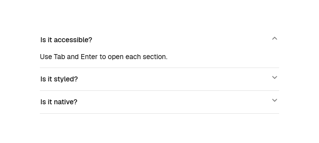 | 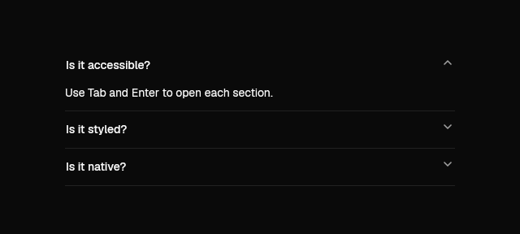 |
| alert-dialog | 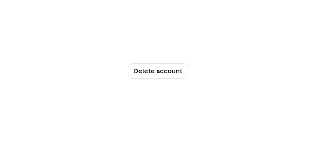 | 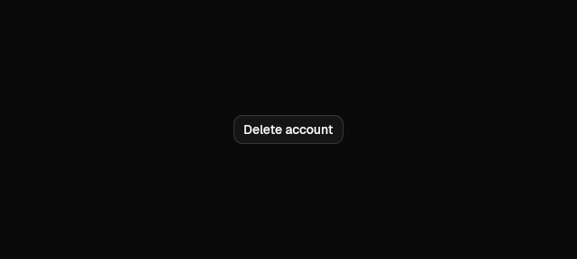 |
| app | 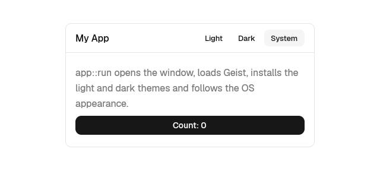 | 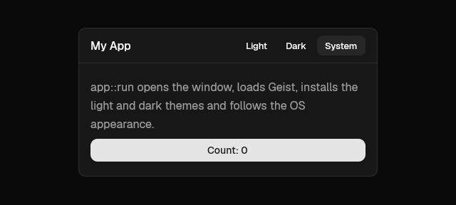 |
| attachment | 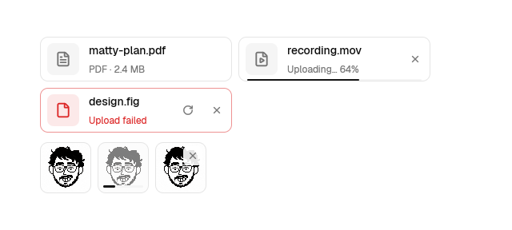 | 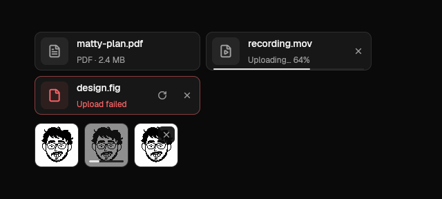 |
| autocomplete | 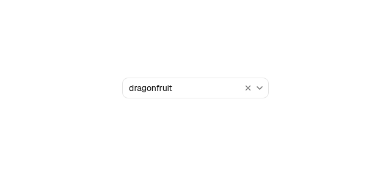 | 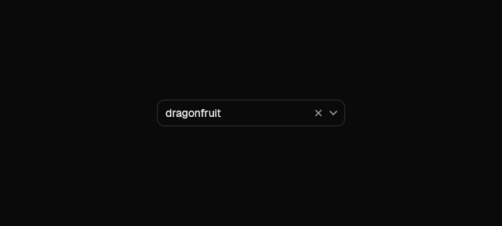 |
| avatar | 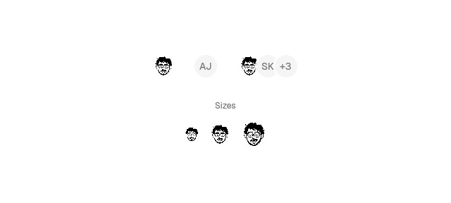 | 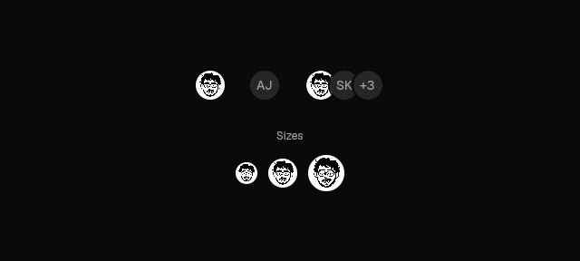 |
| badge | 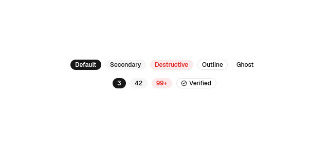 | 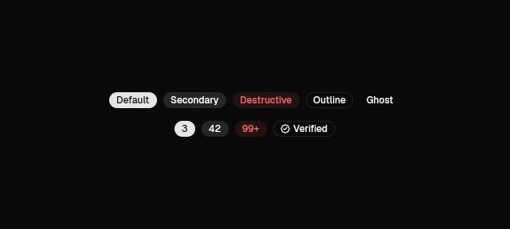 |
| button | 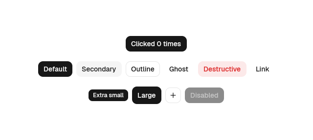 | 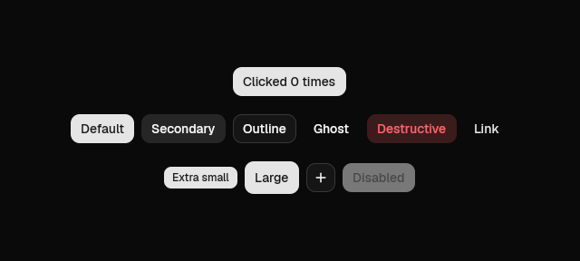 |
| carousel | 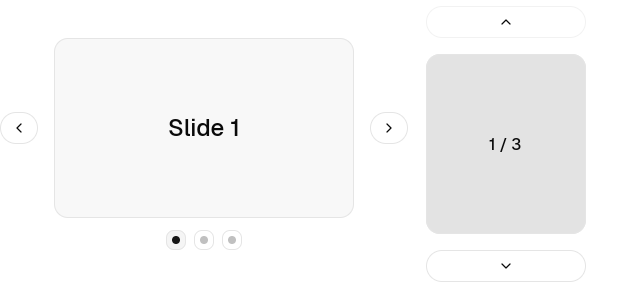 | 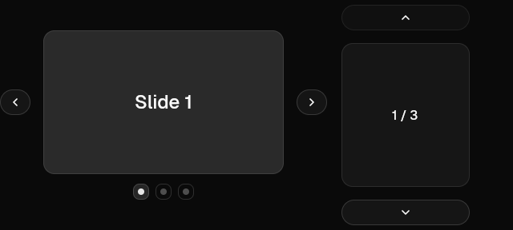 |
| checkbox | 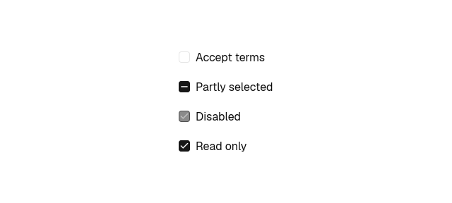 | 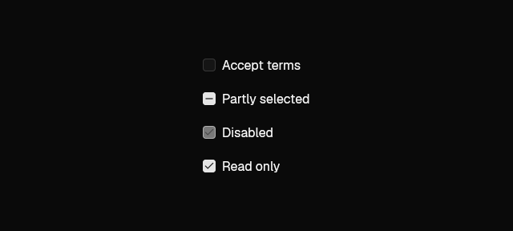 |
| checkbox-group | 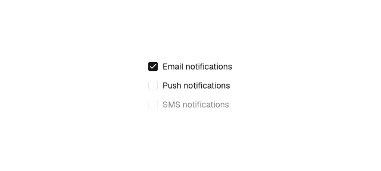 | 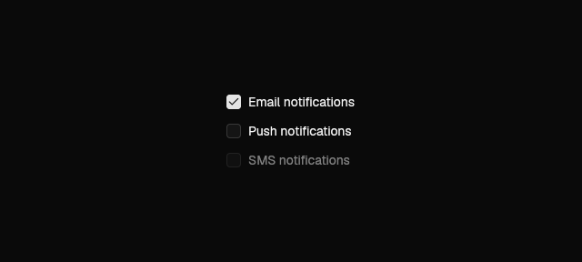 |
| collapsible | 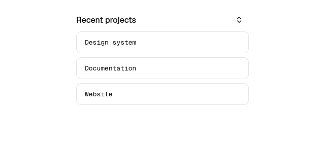 | 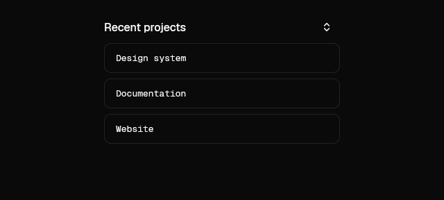 |
| combobox | 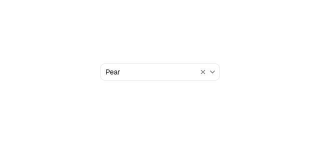 | 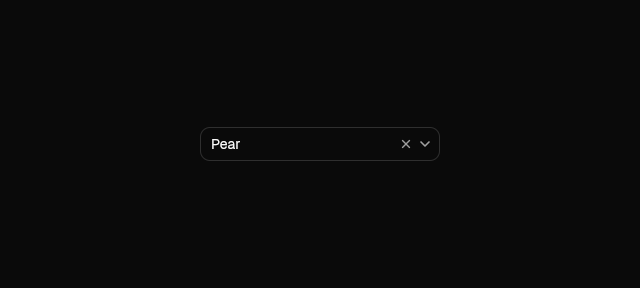 |
| command | 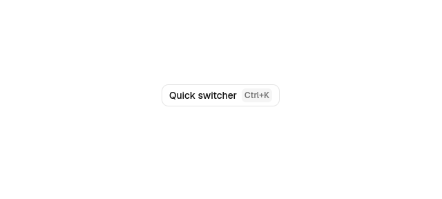 |  |
| composer | 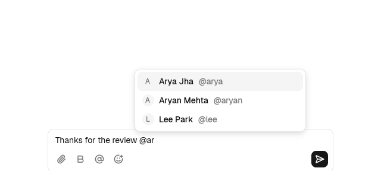 | 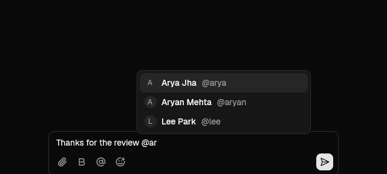 |
| context-menu |  |  |
| dialog |  |  |
| drawer | 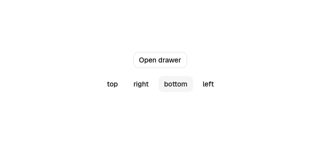 | 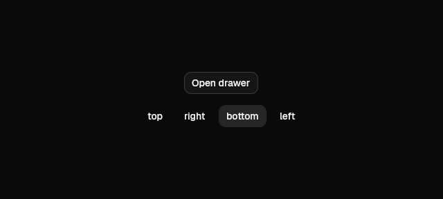 |
| emoji-picker | 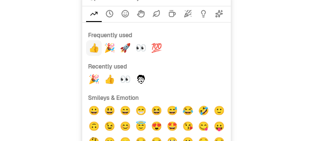 | 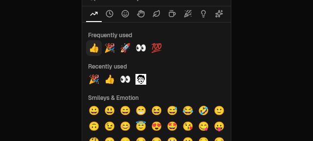 |
| empty | 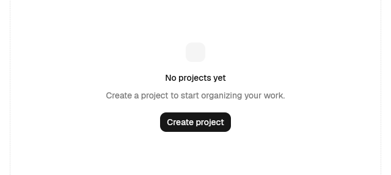 | 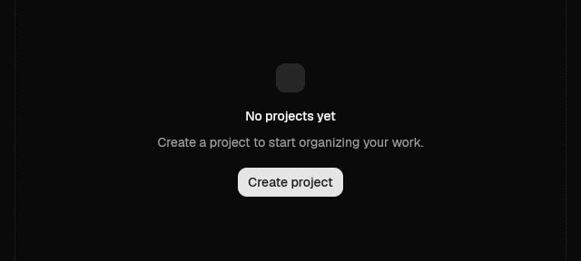 |
| field | 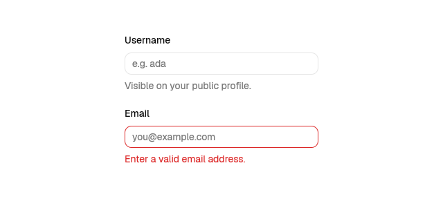 | 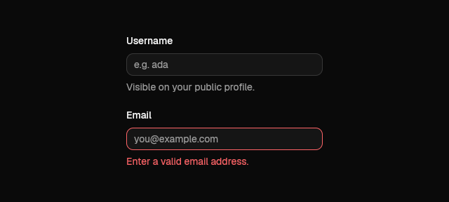 |
| fieldset | 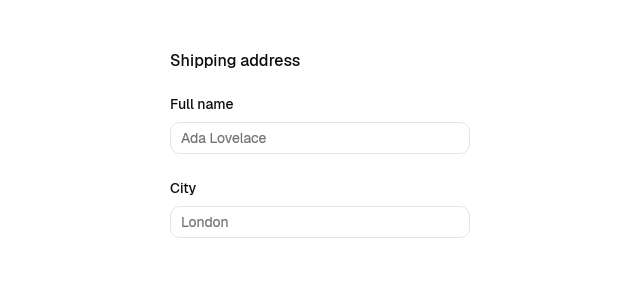 | 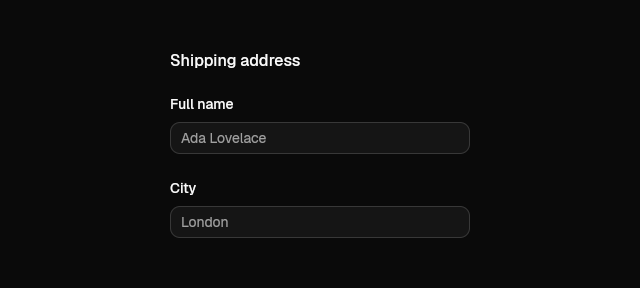 |
| form | 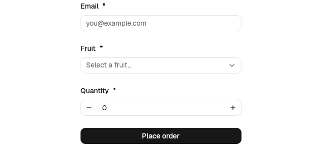 | 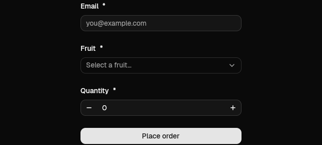 |
| input | 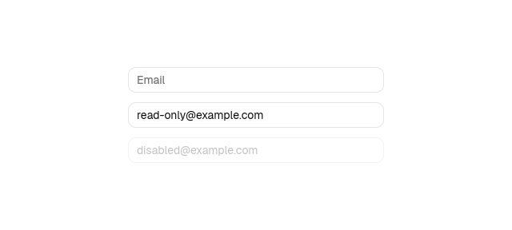 | 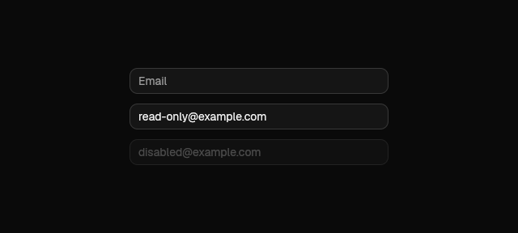 |
| input-group | 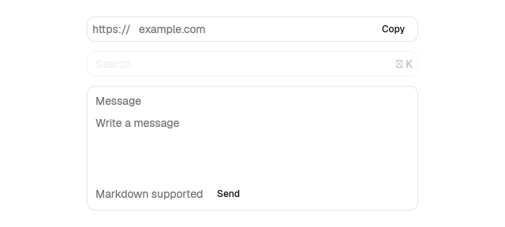 | 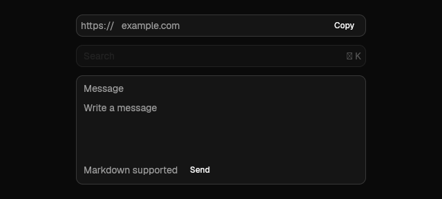 |
| kbd | 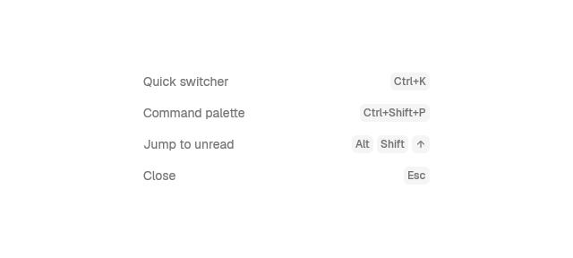 | 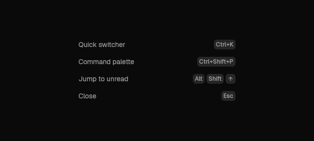 |
| lightbox | 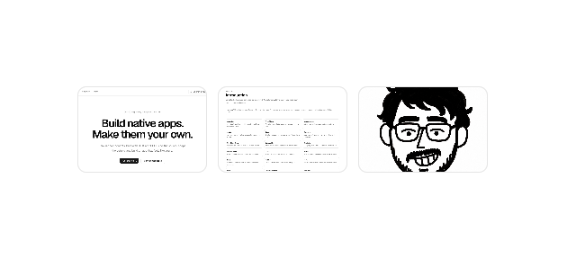 | 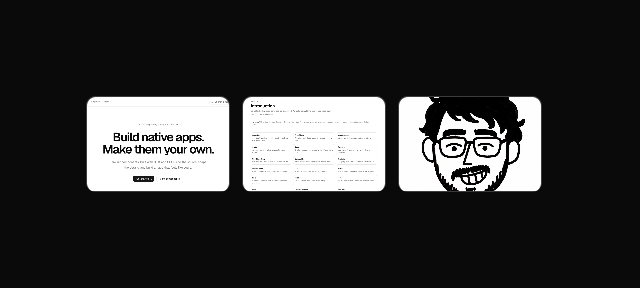 |
| markdown | 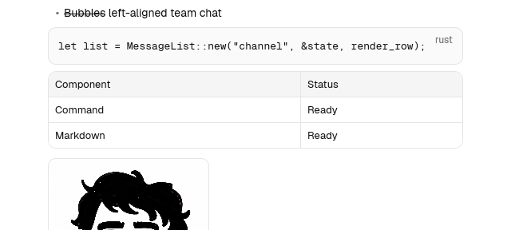 |  |
| menu |  |  |
| menubar |  |  |
| message |  |  |
| message-list |  |  |
| meter |  |  |
| navigation-menu |  |  |
| number-field |  |  |
| otp-field |  |  |
| popover |  |  |
| preview-card |  |  |
| progress |  |  |
| radio-group |  |  |
| resizable |  |  |
| scroll-area |  |  |
| select |  |  |
| separator |  |  |
| sidebar |  |  |
| skeleton |  |  |
| slider |  |  |
| spinner |  |  |
| switch |  |  |
| tabs |  |  |
| tag |  |  |
| textarea |  |  |
| title-bar |  |  |
| toast |  |  |
| toggle |  |  |
| toggle-group |  |  |
| toolbar |  |  |
| tooltip |  |  |
| virtual-list |  |  |

## Changed against /home/user/gpuicn/docs/screenshots/v0.8.0

- composer (light): 1.02% of pixels
- composer (dark): 1.01% of pixels
- form (dark): 5.44% of pixels
- input-group (light): 4.57% of pixels
- input-group (dark): 5.27% of pixels
- message (light): 8.31% of pixels
- message (dark): 0.85% of pixels
- message-list (light): 0.72% of pixels
- message-list (dark): 0.71% of pixels
- number-field (dark): 3.36% of pixels
- tabs (light): 1.98% of pixels
- tabs (dark): 1.97% of pixels
